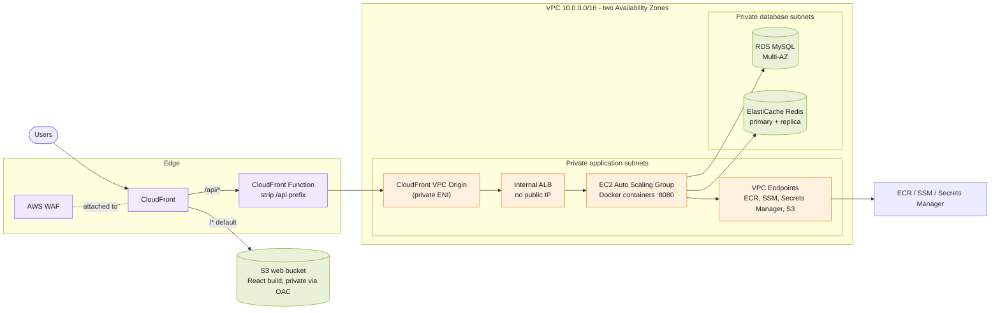
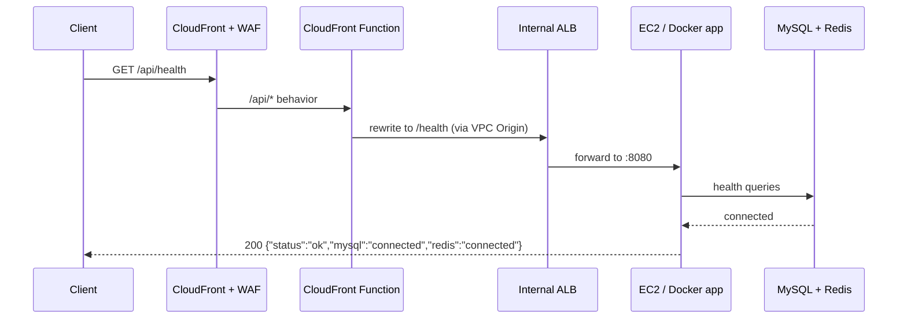
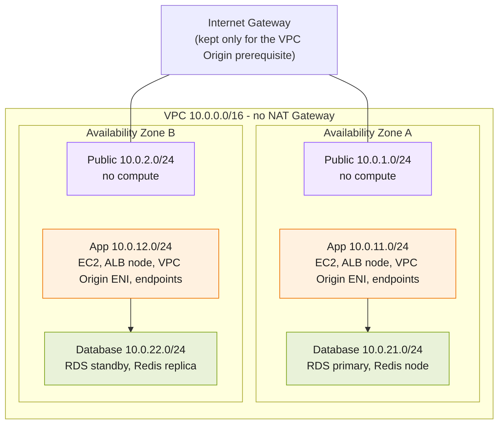
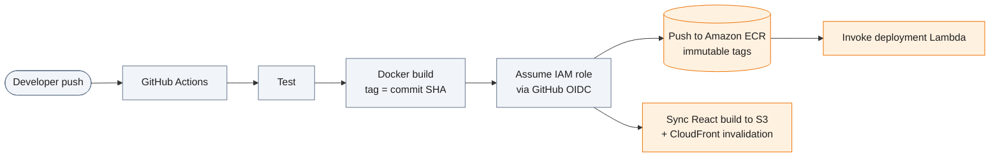
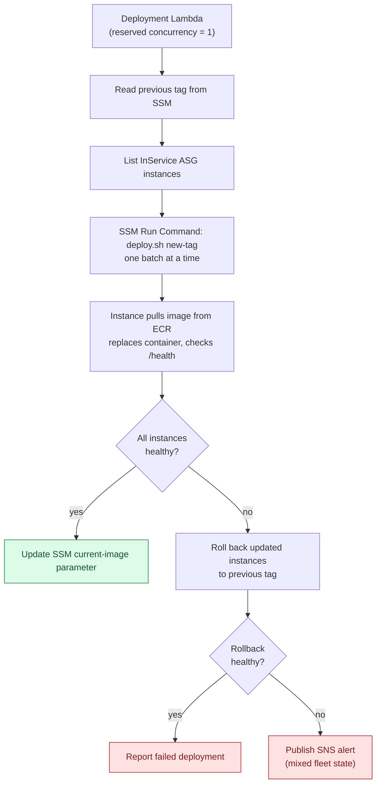
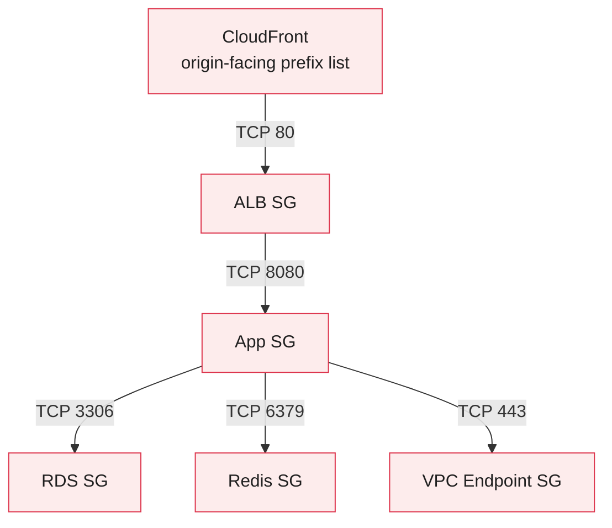

# RetailEdge Inc. - AWS Migration

Migration of RetailEdge Inc. from a bare-metal, co-located stack to AWS. The platform is a three-tier architecture provisioned entirely with Terraform.

- Application repository (Node.js app, Dockerfile, GitHub Actions workflow): [retailedge-app](https://github.com/aliaagamall/retailedge-app/tree/feat/retailedge-aws-integration)
- Architecture diagrams: [View diagrams](https://drive.google.com/file/d/1f83UDA0XaJHnHJWrDPZP6-UHTxyVNDM8/view?usp=drivesdk)

## Table of Contents

1. [Quick Start](#1-quick-start)
2. [Project Background](#2-project-background)
3. [Repository Structure](#3-repository-structure)
4. [Architecture](#4-architecture)
5. [Architecture Evolution](#5-architecture-evolution)
6. [Infrastructure as Code](#6-infrastructure-as-code)
7. [Deployment Pipeline](#7-deployment-pipeline)
8. [Security](#8-security)
9. [Load Testing and Capacity Planning](#9-load-testing-and-capacity-planning)
10. [Validation](#10-validation)
11. [Monitoring](#11-monitoring)
12. [Cost Considerations](#12-cost-considerations)
13. [Project Status](#13-project-status)

---

## 1. Quick Start

```bash
# Clone
git clone https://github.com/aliaagamall/retail-edge-aws.git
cd retail-edge-aws/terraform

# One-time: create the remote state bucket
./scripts/setup-backend.sh

# Initialize, plan, apply (dev)
terraform init -backend-config=environments/dev.backend.hcl
terraform plan -var-file=environments/dev.tfvars -out=tfplan-dev
terraform apply tfplan-dev

# Push Terraform outputs to the app repo (GitHub secrets and variables)
./scripts/sync-github-config.sh

# Validate the deployed stack
./scripts/validation/validate-all.sh

# Tear down when finished (avoids AWS charges)
./scripts/cleanup-before-destroy.sh
terraform destroy -var-file=environments/dev.tfvars
```

Required variables (template: [`terraform.tfvars.example`](./terraform/terraform.tfvars.example)):

| Variable | Purpose |
|---|---|
| `github_org` | GitHub user or organization allowed to deploy |
| `github_repo` | Application repository name |
| `github_branch` | Branch allowed to assume the deploy role |
| `github_owner_id` | GitHub owner ID (immutable OIDC subject) |
| `github_repository_id` | GitHub repository ID (immutable OIDC subject) |
| `alert_email` | Receives CloudWatch alarm notifications |

More detail: [Terraform README](./terraform/README.md).

---

## 2. Project Background

| Item | Detail |
|---|---|
| Company | RetailEdge Inc., mid-size e-commerce |
| Current platform | Three bare-metal servers in a co-location data center |
| Users | ~200,000 monthly active users |
| Peak traffic | ~12,000 concurrent users on Black Friday |
| Migration trigger | Co-location contract expires in 90 days |
| Pain points | 2-3 hours of Black Friday downtime (~$80,000 lost sales); manual deployments take ~4 hours and caused 3 incidents this quarter |
| Approach | Replatform (minimal application changes), not a rewrite |

Requirements:

- [Business Requirements](./docs/requirements/Business%20Requirements.md)
- [Project Constraints](./docs/requirements/Project%20Constraints.md)
- [Technical Requirements](./docs/requirements/Technical%20Requirements.md)

---

## 3. Repository Structure

```text
retail-edge-aws/
├── docs/
│   └── requirements/           # business, constraints, technical requirements
├── diagrams/
│   └── architecture/           # draw.io diagrams 01-04
├── terraform/
│   ├── modules/                # 16 reusable modules (see section 6)
│   ├── environments/           # dev / staging / prod tfvars and backend configs
│   ├── lambda/deploy/          # deployment Lambda (handler.py)
│   ├── scripts/                # backend setup, cleanup, GitHub sync, validation
│   ├── validation-results/     # recorded validation output
│   └── README.md
├── load-testing/               # load-test script, CloudFormation, results, demo
└── README.md
```

---

## 4. Architecture

CloudFront is the only public entry point. The ALB, application tier, and data tier are private.



### API Request Flow

`/api/health` reaches the application as `/health`. The application does not implement an `/api` prefix.



### Network Layout



Only the public subnets route to the Internet Gateway. App and database subnets have no internet route; AWS service traffic uses VPC endpoints.

---

## 5. Architecture Evolution

The editable draw.io sources are in [`diagrams/architecture/`](./diagrams/architecture/). The rendered diagrams are also available on [Google Drive](https://drive.google.com/file/d/1f83UDA0XaJHnHJWrDPZP6-UHTxyVNDM8/view?usp=drivesdk).

| File | Stage | Summary |
|---|---|---|
| [`01-initial-architecture.drawio`](./diagrams/architecture/01-initial-architecture.drawio) | Initial proposal | Three-tier: Route 53, CloudFront, public ALB, EC2 ASG, RDS Multi-AZ, ElastiCache, S3 |
| [`02-network-security-architecture.drawio`](./diagrams/architecture/02-network-security-architecture.drawio) | Network and security | VPC with public, private, and database subnets across two AZs; security group relationships |
| [`03-target-architecture.drawio`](./diagrams/architecture/03-target-architecture.drawio) | Target design | Adds NAT Gateway, IAM roles, Secrets Manager credential flow |
| [`04-retailedge-aws-architecture-cicd.drawio`](./diagrams/architecture/04-retailedge-aws-architecture-cicd.drawio) | Current (as built) | Internal ALB behind CloudFront VPC Origin, WAF, containers on EC2, ECR, GitHub OIDC, Lambda + SSM deployment, monitoring |

Diagrams 01-03 are kept as design history (for example, 03 still includes a NAT Gateway that the final design removed). Diagram 04 is the implemented architecture.

---

## 6. Infrastructure as Code

All infrastructure lives under [`terraform/`](./terraform/). Root files (`alb.tf`, `compute.tf`, `rds.tf`, ...) wire the modules together.

| Module | Purpose |
|---|---|
| [`networking`](./terraform/modules/networking/) | VPC, subnets, route tables, Internet Gateway |
| [`security-groups`](./terraform/modules/security-groups/) | ALB, app, RDS, Redis, and endpoint security groups |
| [`vpc-endpoints`](./terraform/modules/vpc-endpoints/) | Private connectivity to AWS services (no NAT Gateway) |
| [`iam`](./terraform/modules/iam/) | EC2 role, GitHub OIDC provider, deploy role |
| [`alb`](./terraform/modules/alb/) | Internal ALB and target group |
| [`compute`](./terraform/modules/compute/) | Launch Template, Auto Scaling Group, scheduled scaling |
| [`rds`](./terraform/modules/rds/) | MySQL Multi-AZ and its Secrets Manager secret |
| [`elasticache`](./terraform/modules/elasticache/) | Redis replication group and its secret |
| [`ecr`](./terraform/modules/ecr/) | Container image repository |
| [`ssm-parameters`](./terraform/modules/ssm-parameters/) | Currently deployed image tag |
| [`s3`](./terraform/modules/s3/) | Application assets bucket |
| [`s3-web`](./terraform/modules/s3-web/) | Private static website bucket |
| [`cloudfront`](./terraform/modules/cloudfront/) | CDN, VPC Origin, `/api/*` routing, URI rewrite |
| [`waf`](./terraform/modules/waf/) | Web ACL (CLOUDFRONT scope) with logging |
| [`lambda-deploy`](./terraform/modules/lambda-deploy/) | Deployment orchestration Lambda |
| [`monitoring`](./terraform/modules/monitoring/) | CloudWatch alarms, dashboard, SNS |

### Environments

| Setting | dev | staging | prod |
|---|---|---|---|
| RDS deletion protection | No | Yes | Yes |
| RDS backup retention | 0 days | 7 days | 7 days |
| Secrets recovery window | 0 days | 30 days | 30 days |
| ALB deletion protection | No | No | Yes |
| Black Friday scheduled scaling | No | No | Yes |

Config files: [`dev.tfvars`](./terraform/environments/dev.tfvars), [`staging.tfvars`](./terraform/environments/staging.tfvars), [`prod.tfvars`](./terraform/environments/prod.tfvars).

State is stored in the S3 bucket `retailedge-tfstate` with native locking (`use_lockfile = true`).

---

## 7. Deployment Pipeline

The application repository builds and publishes the image; this repository provides the AWS side (ECR, Lambda, SSM, IAM).



### Lambda rollout and rollback



Notes:

- Image tags are immutable, so every deployment uses a new tag (the commit SHA).
- New instances launched by the ASG read the current tag from SSM at boot and deploy it.
- No SSH access: administration uses SSM Session Manager and Run Command.
- CodeDeploy is not used.

Components: [`handler.py`](./terraform/lambda/deploy/handler.py), [`deploy.sh`](./terraform/modules/compute/files/deploy.sh), [`lambda-deploy` module](./terraform/modules/lambda-deploy/), [`lambda-deploy.tf`](./terraform/lambda-deploy.tf).

---

## 8. Security

- App and database subnets have no route to the Internet Gateway.
- AWS service access (ECR, Secrets Manager, SSM, S3) goes through VPC endpoints; there is no NAT Gateway.
- The ALB is internal and accepts traffic only from the CloudFront origin-facing managed prefix list.
- WAF is attached at CloudFront (managed rule sets, SQLi protection, rate limiting).
- Secrets live in Secrets Manager and are read at runtime through the EC2 IAM role.
- GitHub Actions authenticates through OIDC, restricted to one repository and branch; no long-lived AWS keys.
- EC2 uses IMDSv2, encrypted EBS volumes, and SSM instead of SSH.



---

## 9. Load Testing and Capacity Planning

Details: [`load-testing/README.md`](./load-testing/README.md), [`load_test_results.md`](./load-testing/load_test_results.md), [`load_test.sh`](./load-testing/scripts/load_test.sh), [demo video](./load-testing/demo/load-testing-demo.webm).

The test targeted `/health` on a single instance:

| Concurrent Users | Success Rate |
|---:|---:|
| 1,000 | 100% |
| 2,000 | 93.4% |
| 8,000 | 21.7% |
| 12,000 | 15.9% |
| 15,000 | 17.9% |

Planning baseline: ~1,000 concurrent users per instance.

| Scenario | ASG max |
|---|---:|
| Normal days | 10 instances |
| Black Friday (scheduled scaling) | 17 instances (15,000 / ~1,000 plus headroom) |

Production values are in [`prod.tfvars`](./terraform/environments/prod.tfvars). These are planning estimates from a lightweight endpoint and should be revalidated with realistic traffic. The stacks in [`load-testing/cloudformation/`](./load-testing/cloudformation/) are disposable and separate from the Terraform infrastructure.

---

## 10. Validation

Scripts run real AWS CLI checks, not only `terraform validate`.

```bash
cd terraform
./scripts/validation/validate-all.sh    # full suite
./scripts/validation/validate-api.sh    # end-to-end API check
```

Recorded results: [`terraform/validation-results/`](./terraform/validation-results/), including [`api-validation.txt`](./terraform/validation-results/api-validation.txt).

The API validation confirms HTTP 200 through the full path (CloudFront, `/api/*`, VPC Origin, internal ALB, EC2, Docker, MySQL, Redis):

```json
{ "status": "ok", "mysql": "connected", "redis": "connected" }
```

---

## 11. Monitoring

Native AWS services: CloudWatch alarms and dashboard, SNS email notifications. Module: [`monitoring`](./terraform/modules/monitoring/).

| Source | Alarms |
|---|---|
| ALB | 5xx count, P95 latency, unhealthy hosts |
| EC2 / ASG | CPU, memory (CloudWatch Agent) |
| RDS | CPU, connections, free storage |
| Redis | CPU, evictions |
| CloudFront / WAF | 5xx error rate, blocked-request spike |

---

## 12. Cost Considerations

- No NAT Gateway; VPC endpoints are used instead.
- The dev environment was validated end to end, then destroyed to avoid charges. Terraform recreates it on demand.
- An ECR repository with images, and versioned S3 buckets, must be emptied before destroy. [`cleanup-before-destroy.sh`](./terraform/scripts/cleanup-before-destroy.sh) handles both.

---

## 13. Project Status

| Area | Status |
|---|---|
| Requirements, architecture design, diagrams | Done |
| Load testing and capacity planning | Done |
| Terraform infrastructure (all modules) | Implemented |
| Dev environment end-to-end validation | Done |
| CloudFront, VPC Origin, API rewrite, WAF | Implemented |
| Containerized deployment (ECR, Lambda, SSM, rollback) | Implemented |
| GitHub OIDC | Implemented |
| CloudWatch monitoring and SNS alerting | Implemented |
